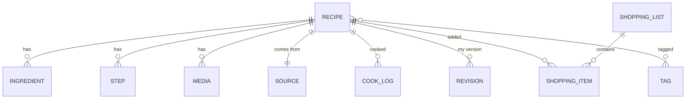

# 数据模型

> 运行时唯一事实源是 Room；`recipe.json` 是可读快照，用于导出与迁移。
> 所有 ID 使用 26 字符 ULID（时间有序、离线可生成、导入导出不变）。

## 1. ER 图



## 2. 表结构

### recipes

| 字段 | 类型 | 说明 |
|---|---|---|
| id | TEXT PK | ULID |
| title | TEXT | 必填 |
| subtitle | TEXT | 通常为 `@作者` |
| coverPath | TEXT? | 相对 `FileStore.root`，如 `recipes/{id}/cover.webp` |
| servings | INT | 基准份量，默认 2 |
| totalMinutes | INT? | 总时长 |
| difficulty | INT | 1-3，UI 暂未展开 |
| notes | TEXT | 备注 |
| sourceId | TEXT? | 指向 sources.id |
| createdAt/updatedAt | INT | epoch millis |
| lastCookedAt | INT? | 最近一次烹饪 |
| favorite | BOOL | 收藏 |
| archived | BOOL | 归档（默认不显示） |

索引：`lastCookedAt`、`updatedAt`、`favorite`。

### sources（一条菜谱一个来源）

| 字段 | 说明 |
|---|---|
| id PK | ULID |
| recipeId | 唯一索引 |
| platform | DOUYIN / XIAOHONGSHU / BILIBILI / OTHER |
| originalUrl | 用户分享的原始链接（短链） |
| canonicalUrl | 解析后的长链（含 xsec_token 等） |
| platformContentId | 平台作品 ID / BV 号 |
| authorName / authorId | 作者 |
| sourceTitle / textBody | 原标题 / 正文 |
| remoteCoverUrl | 远端封面（仅溯源） |
| shareText | 原始分享文案 |
| importedAt | 导入时间 |
| fetchStatus | OK / PARTIAL / MANUAL / FAILED |

**不变量**：平台 + 作者 + 原链接必须展示；`originalUrl` 不允许为空。

### ingredients

| 字段 | 说明 |
|---|---|
| id PK | ULID |
| recipeId | 索引 |
| position | 顺序 |
| groupName | 主料/辅料/酱汁等 |
| name | 名称 |
| amount | 数值，可空 |
| unit | 克/勺/个… |
| rawText | 原文（用于“适量/少许”与溯源） |
| scalable | 是否参与份量缩放 |
| optional | 可选 |

索引：`recipeId`、`name`（搜索）。

### steps

| 字段 | 说明 |
|---|---|
| id PK | ULID |
| recipeId | 索引 |
| position | 顺序 |
| text | 步骤文字，可为空（纯图片步骤） |
| durationSeconds | 建议计时 |
| mediaPath | 该步骤图片相对路径 |
| videoTimestampMs | 对应原视频秒数（预留） |

### media

| 字段 | 说明 |
|---|---|
| id PK | ULID |
| recipeId | 索引 |
| kind | COVER / STEP / PHOTO / VIDEO / AUDIO |
| relativePath | 相对路径，禁止绝对路径 |
| mime | image/webp、video/mp4… |
| width/height/durationMs | 元信息 |
| sizeBytes | 文件大小 |
| sha256 | 内容哈希 |
| originUrl | 远端来源（溯源，不参与播放） |
| watermarkFree | 是否无水印源 |
| createdAt | 导入时间 |

### cook_logs

`recipeId`、`cookedAt`、`servings`、`rating(0-5)`、`notes`、`photoPath`、`durationMinutes`。
索引：`recipeId`、`cookedAt`。

### revisions（我的版本）

`recipeId`、`createdAt`、`title`、`ingredientsJson`、`stepsJson`、`notes`。当前 UI 预留，后续在烹饪记录里展示与切换。

### shopping_lists / shopping_items

清单：`id`、`name`、`createdAt`、`archived`。
条目：`listId`、`name`、`amount`、`unit`、`category`（肉禽水产/蔬菜/蛋奶/调料/其他）、`checked`、`recipeId`、`createdAt`。

### tags / recipe_tags

标签：`id`、`name`（唯一）、`kind`（PRESET/USER）。
关联：`recipeId + tagId` 复合主键。

### drafts（收录草稿）

`shareText`、`url`、`platform`、`state`（RECEIVED→RESOLVING→…→READY/PARTIAL/FAILED）、`error`、`recipeId`、`progress`、`createdAt/updatedAt`。
草稿不进入菜谱库；解析成功后才生成菜谱。

## 3. 关系与一致性

- `RecipeWithDetails` 用 Room `@Relation` 一次取出 ingredients/steps/media/source/tags。
- 保存菜谱是**一个事务**：upsert recipe → 删除旧 ingredients/steps/media → 批量插入 → upsert source。
- 保存后写 `recipe.json` 快照；写失败不影响 DB。
- 删除菜谱：事务删除子表 → 删除整个 `recipes/{id}/` 目录。
- 导入去重：按 `source.canonicalUrl` 查询；已存在则直接返回原菜谱，不重复下载。

## 4. 份量与单位

- `amount` 是数值；`rawText` 保留原文。
- “适量/少许/若干/随意/按需/一点/少量” → `scalable=false`，UI 显示原文。
- 区间 `2-3勺` 存平均值（2.5），UI 用 `rawText` 还原为缩放后的区间。
- 单位不做单位换算（克/毫升/勺各自独立）；后续可加密度表。

## 5. 版本与迁移

- DB version 1，`exportSchema=true`，schema 输出到 `android/app/schemas/`。
- 后续加字段走 Room Migration，禁止 `fallbackToDestructiveMigration`。
- `recipe.json` 有 `version` 字段；恢复时未知字段忽略，缺失字段用默认值。
- 文件布局变更必须写 ADR，并提供旧布局读取路径。

## 6. 快照（recipe.json）

```json
{
  "version": 1,
  "exportedAt": 1793357812286,
  "recipe": { "id": "...", "title": "...", "servings": 2, ... },
  "source": { "platform": "DOUYIN", "originalUrl": "...", "authorName": "..." },
  "ingredients": [ { "name": "牛肉", "amount": 400, "unit": "克", "rawText": "..." } ],
  "steps": [ { "position": 0, "text": "...", "mediaPath": "..." } ],
  "media": [ { "kind": "COVER", "relativePath": "recipes/.../cover.webp" } ]
}
```

Markdown 导出由同一快照生成，包含标题、来源、食材、步骤、备注。
