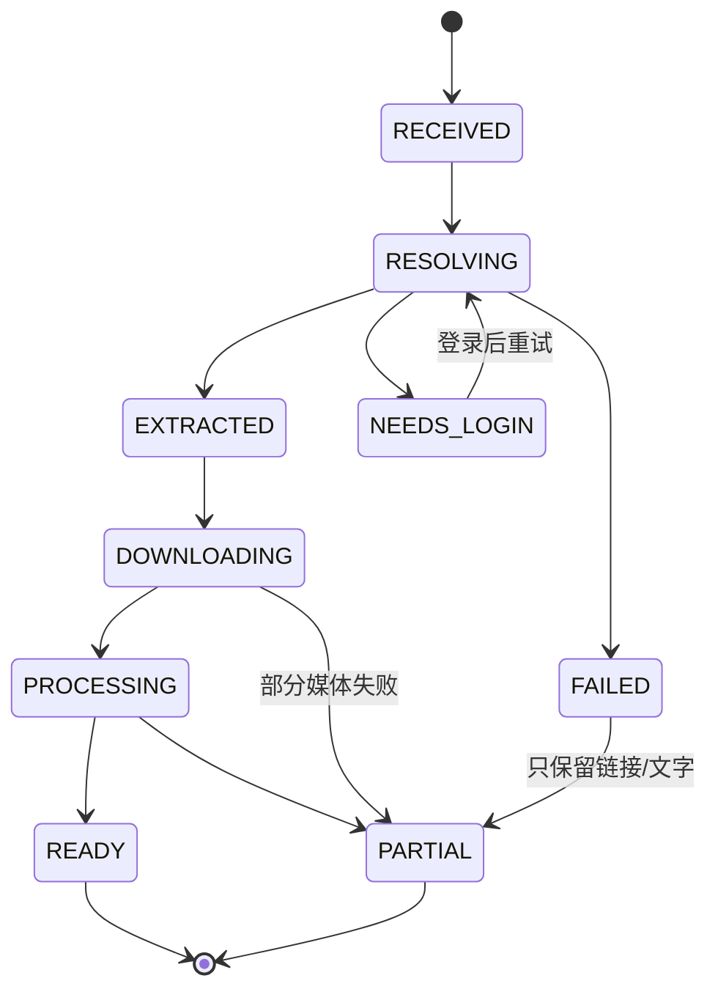

# 收录管线

> 输入：用户主动分享/粘贴的一条链接。输出：一条可打开的菜谱（含媒体与来源）。
> 原则：能做多少做多少；任何失败都保留已拿到的数据；不做批量、不破解签名、不做 AI 抹水印。

## 1. 状态机



- 草稿（drafts 表）贯穿全过程；成功后 `recipeId` 关联。
- `PARTIAL` 是正常终态：用户随时可以编辑补全。

## 2. 入口

| 入口 | 实现 | 说明 |
|---|---|---|
| 系统分享 | `ShareReceiverActivity`（SEND text/plain、image/*、video/*、SEND_MULTIPLE） | 接收文本后启动 MainActivity 并带 `share_text` |
| 应用内粘贴 | CaptureScreen 文本框 + 前台读剪贴板 | 进入页面自动填充，用户确认后解析 |
| 手动创建 | EditScreen（`edit/new`） | 不解析任何链接 |
| 桌面快捷方式/QS Tile | 预留 | 直接打开 CaptureScreen |

不做：后台剪贴板监听、自动打开平台 App、批量导入。

## 3. 提取器接口

```kotlin
interface PlatformExtractor {
    val platform: Platform
    suspend fun extract(link: ParsedLink): ExtractedContent
}

data class ExtractedContent(
    val platform: Platform,
    val canonicalUrl: String,
    val contentId: String?,
    val title: String,
    val author: String?,
    val authorId: String?,
    val textBody: String,
    val tags: List<String>,
    val coverUrl: String?,
    val media: List<RemoteMedia>,   // URL + mime + 尺寸 + 无水印 + headers
    val fetchStatus: FetchStatus,
    val message: String?,
    val durationMs: Long?,
    val requiresWebView: Boolean,
    val webViewUrl: String?,
)
```

`ExtractorRegistry` 按域名路由：抖音 / 小红书 / B站 / 通用（仅保留链接与文字）。

## 4. 平台适配器

### 4.1 B站（最稳定）

1. `b23.tv` 短链 HEAD 跟随 302 → `BV...`。
2. `x/web-interface/view?bvid=` → 标题、UP 主、封面、时长、cid。
3. `x/player/playurl?qn=64&fnval=1` → `durl[0].url`（720p 单文件）。
4. 媒体请求使用**桌面 UA** + `Referer: https://www.bilibili.com/`；移动 UA 会 403。
5. 封面作为 COVER，视频作为 VIDEO；失败时只保留封面与文字。

### 4.2 小红书

1. `xhslink.cn` 短链 HEAD 跟随 302，保留 `xsec_token`。
2. GET 笔记页（移动 UA + 可选 Cookie）。
3. 解析 `window.__INITIAL_STATE__` → `noteData.data.noteData`：
   - 图片：`imageList[].fileId` → `https://ci.xiaohongshu.com/{fileId}`（无水印原图）；
   - 视频：`video.media.stream.h264[0].masterUrl`（HTTP→HTTPS）；
   - 文字：`title` / `desc` / `tagList`。
4. 风控（300031/300015/461/登录页）→ `NEEDS_LOGIN`，引导 WebView 登录后重试。

### 4.3 抖音（三级降级）

1. **JSON-LD 兜底（匿名）**：`Googlebot` UA 打开 `www.douyin.com/{video|note}/{id}`：
   - 图文 `article` → 标题、正文、`image[]` 原图 → 直接可导入；
   - 视频 `VideoObject` → 标题、封面、`name` 里的食材、时长 → 生成 `PARTIAL` 内容，并标记 `requiresWebView=true`。
2. **WebView**：加载 `www.douyin.com/video/{id}`（桌面 UA）→ 注入 XHR/fetch 钩子捕获页面自身签名的 detail 响应 → `aweme_detail`：
   - `video.play_addr.url_list`（无水印）优先；**不取** `download_addr`；
   - `images[].url_list` 原图；
   - `desc` / `author` / `duration`。
3. **拦截重放（备用）**：`shouldInterceptRequest` 捕获 detail 请求，用同 URL + 页面 Cookie 在后台重放；但**不替换页面响应**（否则页面拿不到数据）。
4. 15 秒内无结果 / 渲染崩溃 / detail 返回 200+0 字节 → 用 JSON-LD 内容生成 `PARTIAL`，提示"视频需要登录抖音后重试"。
5. 图片规则：只接受 `~tplv-dy-aweme-images` 模板；过滤头像、作者其他作品 300×400 缩略图、页面静态资源。

## 5. 下载

`MediaDownloader`：

- OkHttp，`Accept: */*`，平台 headers（UA/Referer/Cookie）。
- 已有 `.part` 时发 `Range: bytes=N-`；206 追加，200 重写。
- 进度回调 0-100；总长未知时 -1。
- 完成后 `rename`，计算 sha256/尺寸。
- 单条顺序下载（不做并发），失败不阻塞其他媒体。
- 下载前检查剩余空间（需求 + 100MB）。

| 平台 | UA | Referer | 备注 |
|---|---|---|---|
| 抖音 | Mobile Chrome | `https://www.douyin.com/` | CDN 需要 Referer |
| 小红书 | Mobile Chrome | `https://www.xiaohongshu.com/` | 图片/视频同理 |
| B站 | **Desktop Chrome** | `https://www.bilibili.com/` | 移动 UA 403 |

## 6. 图片处理

- 下载后按最长边 1600 采样解码 → EXIF 旋转 → WebP q85 → 原子替换。
- 封面固定 `cover.webp`；步骤图 `step-NN.webp`；用户照片 `photo-NN.webp`。
- 无封面但有视频时，用 `MediaMetadataRetriever` 抽第 1 秒帧作为封面。
- GIF/解码失败时保留原文件，扩展名降级为 `.jpg`，不阻断导入。

## 7. 文字解析

`TextParser`：

- 先去掉话题标签、@、口令碎片；
- 识别“食材/用料/配料/酱汁”等小标题；
- 支持 `名称：数量单位`、`数量单位 名称`、`2-3勺`、`约4瓣`、`适量水`；
- 步骤只认“步骤/做法”段落或编号行；**没有结构就留空**，不把宣传语或标签当步骤；
- 图文没有文字步骤时，把图片本身生成为图片步骤（`text=""`，UI 显示“按图示操作”）；
- 置信度：食材 ≥3 且步骤 ≥2 → 0.9；否则按命中数降级。

## 8. 失败与降级矩阵

| 失败点 | 用户看到 | 系统保留 |
|---|---|---|
| 短链无法展开 | 失败 + 重试/手动 | 原链接、分享文案 |
| 页面 403/风控 | 需要登录 | 链接、标题线索 |
| WebView 渲染崩溃 | 15s 后部分完成 | JSON-LD 标题/封面/食材 |
| detail 200/0 | 部分完成，提示登录 | 同上 |
| 视频下载失败 | 部分完成 | 封面/图片/文字 |
| 图片下载失败 | 部分完成 | 其他图片/文字 |
| 空间不足 | 跳过媒体 | 文字、链接 |
| 文字解析失败 | 菜谱可用、食材/步骤为空 | 原文可读、可编辑 |

## 9. 登录态

- 应用内 WebView 由用户自行登录；应用不读取账号密码。
- 点“我已登录”后读取 `CookieManager` 对应域 Cookie，加密保存。
- 解析时作为 `Cookie` 头发送；不写日志、不进导出包。
- 设置页可一键清除全部登录信息。

## 10. 验证

- 单元测试：`TextParserTest`、`DouyinJsonLdParserTest`、`DouyinJsonParserTest`、`XhsWebViewParserTest`、`ExtractorMockTest`（MockWebServer）。
- 真机回归样本见 [`test-data.md`](test-data.md)。
- 平台改版排查顺序：短链 → 页面/接口 → 字段路径 → 下载 headers → 文件落盘。
