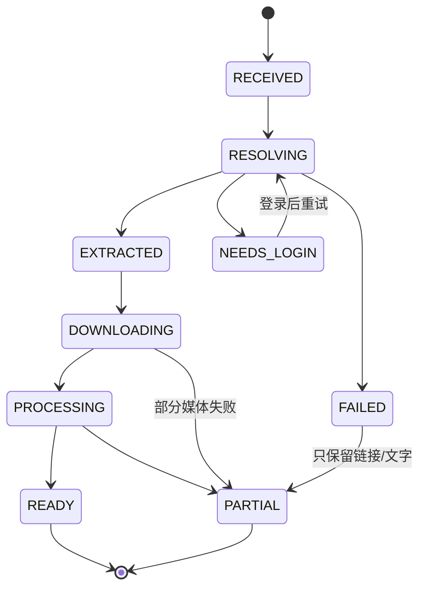

# 收录管线

> 输入：用户主动分享/粘贴的一条链接。输出：一条可打开的菜谱（含媒体与来源）。
> 原则：能做多少做多少；任何失败都保留已拿到的数据；不做批量、不破解签名、不做 AI 抹水印。

## 1. 状态机



- 草稿（drafts 表）贯穿全过程；成功后 `recipeId` 关联。
- `PARTIAL` 是正常终态：用户随时可以编辑补全。

## 2. 入口

| 入口 | 实现 | 说明 |
|---|---|---|
| 系统分享 | `ShareReceiverActivity`（SEND text/plain、image/*、video/*、SEND_MULTIPLE） | 接收文本后启动 MainActivity 并带 `share_text` |
| 应用内粘贴 | CaptureScreen 文本框 + 前台读剪贴板 | 进入页面自动填充，用户确认后解析 |
| 手动创建 | EditScreen（`edit/new`） | 不解析任何链接 |
| 桌面快捷方式/QS Tile | 预留 | 直接打开 CaptureScreen |

不做：后台剪贴板监听、自动打开平台 App、批量导入。

## 3. 提取器接口

```kotlin
interface PlatformExtractor {
    val platform: Platform
    suspend fun extract(link: ParsedLink): ExtractedContent
}

data class ExtractedContent(
    val platform: Platform,
    val canonicalUrl: String,
    val contentId: String?,
    val title: String,
    val author: String?,
    val authorId: String?,
    val textBody: String,
    val tags: List<String>,
    val coverUrl: String?,
    val media: List<RemoteMedia>,   // URL + mime + 尺寸 + 无水印 + headers
    val fetchStatus: FetchStatus,
    val message: String?,
    val durationMs: Long?,
    val requiresWebView: Boolean,
    val webViewUrl: String?,
)
```

`ExtractorRegistry` 按域名路由：抖音 / 小红书 / B站 / 通用（仅保留链接与文字）。

## 4. 平台适配器

### 4.1 B站（最稳定）

1. `b23.tv` 短链 HEAD 跟随 302 → `BV...`。
2. `x/web-interface/view?bvid=` → 标题、UP 主、封面、时长、cid。
3. `x/player/playurl?qn=64&fnval=1` → `durl[0].url`（720p 单文件）。
4. 媒体请求使用**桌面 UA** + `Referer: https://www.bilibili.com/`；移动 UA 会 403。
5. 封面作为 COVER，视频作为 VIDEO；失败时只保留封面与文字。

### 4.2 小红书

1. `xhslink.cn` 短链 HEAD 跟随 302，保留 `xsec_token`。
2. GET 笔记页（移动 UA + 可选 Cookie）。
3. 解析 `window.__INITIAL_STATE__` → `noteData.data.noteData`：
   - 图片：`imageList[].fileId` → `https://ci.xiaohongshu.com/{fileId}`（无水印原图）；
   - 视频：`video.media.stream.h264[0].masterUrl`（HTTP→HTTPS）；
   - 文字：`title` / `desc` / `tagList`。
4. 风控（300031/300015/461/登录页）→ `NEEDS_LOGIN`，引导 WebView 登录后重试。

### 4.3 抖音（移动分享页 + 三路嗅探）

**2026-11-04 实测（curl + WebView 日志）**

| 探测对象 | 结果 |
|---|---|
| `v.douyin.com` 短链 | 302 → `https://www.iesdouyin.com/share/video/{id}/?...`，分享页 200 / 35KB |
| 分享页 `window._ROUTER_DATA` | 只剩 `itemId` 与 AB 参数，**已不含 `video.play_addr`** |
| 分享页自己的请求 | `/web/api/v2/aweme/iteminfo/`，参数含 `use_new_select_scope`、`item_ids`、`aweme_type`、`reflow_id`、`share_scene`、`share_token`、`scene_from`；由页面安全 SDK 签名 |
| OkHttp 直连 iteminfo | 200 / **0 字节** |
| OkHttp 直连 `/aweme/v1/web/aweme/detail/` | 403 `Blocked by ArgusSecurityPlugin Uifid Not Found` |
| `www.douyin.com/video/{id}` 桌面 UA | JS 反爬壳，无媒体 |
| 同 URL 换 Googlebot/Baiduspider UA | 100KB SEO 页，只有标题/封面/正文，**无直链** |

结论：唯一可靠的匿名路径是**在 WebView 里让移动分享页自己发签名请求**，应用只被动读取，不伪造签名、不替换页面响应。

**降级链**

0. **短链展开**：`v.douyin.com` HEAD 跟随 302，从 `share/video\|slides/{id}` 取 `contentId`。
1. **SEO / JSON-LD 兜底（匿名）**：`Googlebot` UA 打开 `www.douyin.com/{video|note}/{id}`：
   - 图文 `article` → 标题、正文、`image[]` 原图 → 直接可导入，不进 WebView；
   - 视频 `VideoObject` → 标题、封面、`name` 里的食材、时长 → 生成 `PARTIAL` 内容并标记 `requiresWebView=true`。
2. **移动分享页 WebView**（分享页优先；`www.douyin.com/video/{id}` 只在分享页报错时兜底）：
   - 地址优先级：① 短链 302 得到的 `https://www.iesdouyin.com/share/...` **原样使用**（保留 `did`/`iid`/`share_sign`/`ts`/`region` 等参数，丢掉后无头环境直接渲染「抱歉出错了」）→ ② 否则构造干净的 `share/video/{id}/`（图文 `share/slides/{id}/`）→ ③ 没有 `contentId` 时退回短链解析结果。干净地址 2026-11-04 实测也返回 200 / 32.5KB，但它不是中国区外的可靠入口，只作兜底；
   - UA 用移动端（桌面 UA 会被导向反爬壳）；
   - 页面可能弹 `snssdk1128://` 拉起抖音 App：`shouldOverrideUrlLoading` 拦掉所有非 http(s) scheme，否则会盖住播放器或跳走；
   - `WebViewCompat.addDocumentStartJavaScript` 在每个新文档开始前注入 hook（页面首次导航后会 reload，`onPageStarted` 注入会随旧文档丢失，保留作兜底）；XHR 兼容 `responseType=json`；
   - **三路同时收**：① XHR/fetch 响应体（`item_list` / `aweme_detail`）；② `performance.getEntriesByType('resource')` 里的媒体直链（`douyinvod` / `byteicdn` / `video/tos` / `.mp4`）；③ `<video>.currentSrc`。探针先 `muted=true; play()` 静默触发一次播放（播放器默认不一定自动播，不触发就不会有 media 请求），读完 `currentSrc` 再读 resource timing。页面加载完成后 2.5s 起每 2.5s 探一次，最多约 35s；
   - **成功判据**：视频链接必须解析出 `MediaKind.VIDEO`；只有 `og:image` 封面不算成功，继续探到超时。只有图文才接受图片；
   - **错误页兜底**：探针读到页面出现「抱歉出错了 / 请尝试在抖音内观看 / 作品不存在」且当前是分享页时，自动改载旧路径 `https://www.douyin.com/{video|note}/{id}` 再试一轮；两轮都拿不到 `VIDEO` 才走超时兜底；
   - **直链候选**：只认 `douyinvod` / `byteicdn` / `video/tos` / `.mp4`；`performance` 里出现 `aweme/v1/play` 也不当候选（它是签名跳转口，App 内下载 403）；
   - 解析顺序：`item_list`（iteminfo）→ `aweme_detail`（含 `aweme_detail.aweme_detail` 二次包裹）→ 页面 HTML → 只有直链的合成路径；
   - ID 必须匹配：链接带 `contentId` 时，响应里 `aweme_id` 不同的条目一律丢弃（页面会预取相关推荐）。
3. **只有直链、没有 JSON**：分享页真实播放时嗅到的 CDN 地址 + SEO 的标题/作者/封面，合成一条 `VIDEO` 媒体（`DouyinJsonParser.synthesize`）；`duration` 未知，不猜。
4. **拦截重放（备用）**：`shouldInterceptRequest` 捕获 iteminfo/detail 请求，用同 URL + 页面 Cookie 在后台重放；**不替换页面响应**（否则页面拿不到数据、视频反而不会加载）。匿名重放多数返回 200/0 或 403，属预期。
5. **超时**：45 秒内没有 `VIDEO` / 渲染崩溃 / 未登录 → 用 SEO 内容生成 `PARTIAL`，文案给出「重试 / 去登录扫码 / 只保留链接」三条出口。
6. **图片规则**：只接受 `~tplv-dy-aweme-images` 模板；过滤头像、作者其他作品 300×400 缩略图、页面静态资源。
7. **视频直链规则**：优先直连 CDN（`douyinvod` / `byteicdn` / `video/tos`），其次 `mime_type=video_mp4`，最后才用 `url_list` 里剩下的地址；`/aweme/v1/play/` 是带签名的跳转口，App 里容易被判 403。**不取** `download_addr`（带水印）。

## 5. 下载

`MediaDownloader`：

- OkHttp，`Accept: */*`，平台 headers（UA/Referer/Origin/Cookie）；`RemoteMedia.headers` 优先于默认头。
- 抖音视频请求默认补 `Referer: https://www.douyin.com/`、`Origin: https://www.douyin.com`、`Accept: */*`（缺 Referer/Origin 时 CDN 403）；B 站/小红书用自己的平台头覆盖，不会被抖音默认头污染。
- 已有 `.part` 时发 `Range: bytes=N-`；206 追加，200 重写。
- 进度回调 0-100；总长未知时 -1。
- 完成后 `rename`，计算 sha256/尺寸。
- 单条顺序下载（不做并发），失败不阻塞其他媒体。
- 失败原因透传到 `ImportResult.message`（例：`HTTP 403（CDN 拒绝下载，直链可能已过期，重新解析一次）`）；直链失效时 CDN 会返回验证页，响应 `content-type` 是 `text/html` 或 0 字节即判失败，不落盘。
- 下载前检查剩余空间（需求 + 100MB）。

| 平台 | UA | Referer | 备注 |
|---|---|---|---|
| 抖音 | Mobile Chrome | `https://www.douyin.com/` + `Origin` 同值 | 视频 CDN 缺少 Referer/Origin 返回 403；优先直连 `douyinvod`/`byteicdn` |
| 小红书 | Mobile Chrome | `https://www.xiaohongshu.com/` | 图片/视频同理 |
| B站 | **Desktop Chrome** | `https://www.bilibili.com/` | 移动 UA 403 |

## 6. 图片处理

- 下载后按最长边 1600 采样解码 → EXIF 旋转 → WebP q85 → 原子替换。
- 封面固定 `cover.webp`；步骤图 `step-NN.webp`；用户照片 `photo-NN.webp`。
- 无封面但有视频时，用 `MediaMetadataRetriever` 抽第 1 秒帧作为封面。
- GIF/解码失败时保留原文件，扩展名降级为 `.jpg`，不阻断导入。

## 7. 文字解析

`TextParser`：

- 先去掉话题标签、@、口令碎片；
- 识别“食材/用料/配料/酱汁”等小标题；
- 支持 `名称：数量单位`、`数量单位 名称`、`2-3勺`、`约4瓣`、`适量水`；
- 步骤只认“步骤/做法”段落或编号行；**没有结构就留空**，不把宣传语或标签当步骤；
- 图文没有文字步骤时，把图片本身生成为图片步骤（`text=""`，UI 显示“按图示操作”）；
- 置信度：食材 ≥3 且步骤 ≥2 → 0.9；否则按命中数降级。

## 8. 失败与降级矩阵

| 失败点 | 用户看到 | 系统保留 |
|---|---|---|
| 短链无法展开 | 失败 + 重试/手动 | 原链接、分享文案 |
| 页面 403/风控 | 需要登录 | 链接、标题线索 |
| WebView 渲染崩溃 | 40–45s 后部分完成 | JSON-LD 标题/封面/食材 |
| 分享页没返回 JSON（200/0 或 403 Argus） | 部分完成：重试 / 去登录扫码 / 只保留链接 | 同上 |
| 分享页只暴露直链、无 JSON | 正常完成（合成 VIDEO，时长未知） | 直链 + SEO 标题/作者/封面 |
| 直链过期 / CDN 403 | 部分完成，文案带 HTTP 状态与「重新解析」 | 封面/图片/文字 |
| 视频下载失败 | 部分完成 | 封面/图片/文字 |
| 图片下载失败 | 部分完成 | 其他图片/文字 |
| 空间不足 | 跳过媒体 | 文字、链接 |
| 仅 Wi-Fi 下载开启 + 当前非 Wi-Fi | 部分完成：明确提示「已跳过媒体下载（仅 Wi-Fi…）」，不下载封面兜底 | 链接、文字 |
| 「自动下载视频与图片」关闭 | 部分完成：明确提示跳过媒体 | 链接、文字 |
| VPN 接管 activeNetwork | 按底层网络是否计费判断，Wi-Fi 上的 VPN 不再误判为移动网络 | 正常下载媒体 |
| 文字解析失败 | 菜谱可用、食材/步骤为空 | 原文可读、可编辑 |

## 9. 登录态

- 应用内 WebView 由用户自行登录；应用不读取账号密码。
- 点“我已登录”后读取 `CookieManager` 对应域 Cookie，加密保存。
- 解析时作为 `Cookie` 头发送；不写日志、不进导出包。
- 设置页可一键清除全部登录信息。

## 10. 验证

- 单元测试：`TextParserTest`、`DouyinJsonLdParserTest`、`DouyinJsonParserTest`、`XhsWebViewParserTest`、`ExtractorMockTest`（MockWebServer）。
- 真机回归样本见 [`test-data.md`](test-data.md)。
- 平台改版排查顺序：短链 → 页面/接口 → 字段路径 → 下载 headers → 文件落盘。
